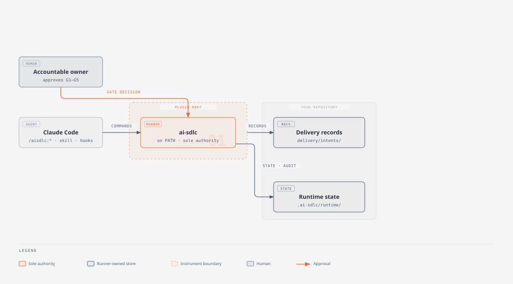
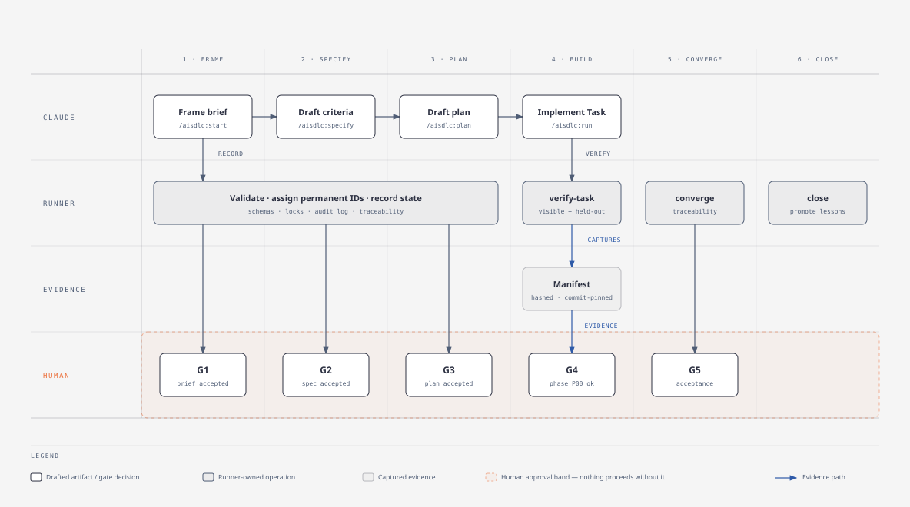
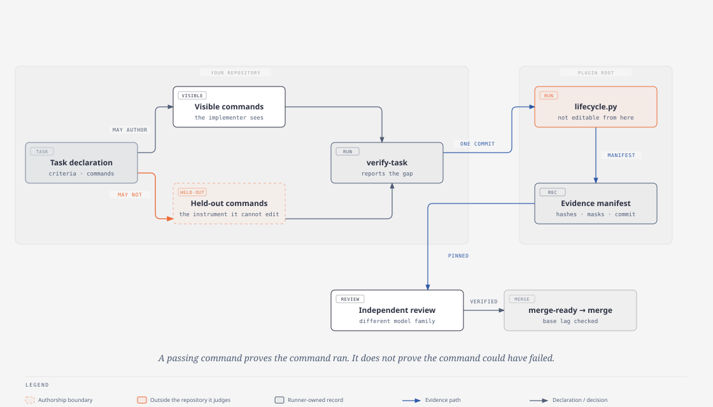
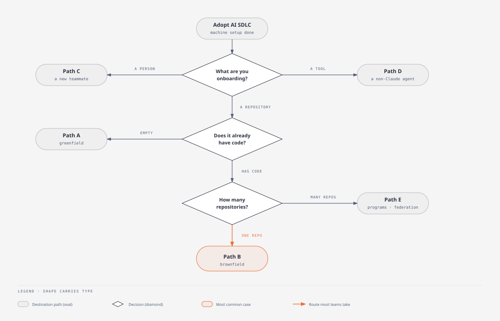

# AI SDLC: Adaptive Evidence-Driven Lifecycle for AI-Assisted Engineering

[](LICENSE)


**A Claude Code plugin and a deterministic runner that take an AI-assisted change from intent to accepted, verified
result, with human gates, commit-pinned evidence, independent review, and an audit trail you can defend six months
later.**

Claude helps people reason, draft, implement, and review. The runner owns everything a conversation must not be
trusted with: identifiers, lifecycle state, gates, locks, evidence, retries, and traceability. People approve five
gates. The code that captures evidence lives outside the repository it judges, so **an agent cannot grade its own
work.**

<p align="center">
  
</p>

Two principles do most of the work, and both are enforced in code rather than requested in a prompt:

> **The instrument that decides a criterion is not authored in the context that satisfies it.**
> A passing command proves the command ran. It does not prove the command *could have failed*.

> **Independence is a property of the model, not of the persona name.**
> A reviewer running the implementer's model family reviews its own work, whatever it is called.

---

## Contents

- [Is this for you?](#is-this-for-you)
- [Why teams adopt it](#why-teams-adopt-it)
- [The lifecycle in one picture](#the-lifecycle-in-one-picture)
- [Install](#install)
- [Quickstart: your first verified Task](#quickstart-your-first-verified-task)
- [How a Task is verified](#how-a-task-is-verified)
- [Adopting it across a team or organisation](#adopting-it-across-a-team-or-organisation)
- [Security, trust model, and compliance](#security-trust-model-and-compliance)
- [AISDLC Studio](#aisdlc-studio)
- [Documentation](#documentation)
- [Support, versioning, and compatibility](#support-versioning-and-compatibility)
- [Contributing and license](#contributing-and-license)

---

## Is this for you?

| Use it when                                                                      | Skip it when                                                                     |
| -------------------------------------------------------------------------------- | -------------------------------------------------------------------------------- |
| An AI agent writes code you have to stand behind                                 | You are prototyping and nobody will ask what happened                            |
| "How do we know it works?" needs an answer that is not a screenshot              | The change is a typo fix                                                         |
| Someone will audit the change — a regulator, a customer, a post-incident review | You already have a lifecycle you trust and nobody wants a second one             |
| Model behaviour is part of the product, so tests alone cannot settle correctness | The work is release or deployment — that is deliberately outside this lifecycle |

The framework is **inert until you opt in**. Installing the plugin changes nothing in repositories that have never run `ai-sdlc init`: the guard hooks recognise an unmanaged repository and exit silently.

---

## Why teams adopt it

| Concern                                           | What the framework does about it                                                                                                                                                                                                               |
| ------------------------------------------------- | ---------------------------------------------------------------------------------------------------------------------------------------------------------------------------------------------------------------------------------------------- |
| **"Did the AI actually verify this?"**      | The runner executes every declared check itself, outside the repository under change, and records commands, exit codes, output hashes, and the Git commit in an evidence manifest. A Task without captured evidence cannot be marked complete. |
| **"It passes its own tests."**              | Tasks declare *held-out* checks the implementer may not author. A visible suite that passes while the held-out suite fails is a specification-conformance finding, not a flaky test.                                                         |
| **"Who reviewed it?"**                      | Reviews are rejected unless the reviewer runs a different model family from the implementer. Self-review is refused, not discouraged.                                                                                                          |
| **"Who approved it, and when?"**            | Five human gates (outcome, specification, plan, walking skeleton, acceptance) with a configurable approver policy, recorded in an append-only audit log.                                                                                       |
| **"Can we show an auditor?"**               | Bidirectional traceability from requirement to criterion to Task to evidence, and a read-only conformance export onto NIST AI RMF, ISO/IEC 42001 Annex A, and NIST SSDF.                                                                       |
| **"We have a legacy codebase."**            | Brownfield onboarding builds an anchored understanding of the system and pins current behaviour as a baseline, so the first criterion can be "no worse than today".                                                                            |
| **"Different work needs different rigor."** | Pipeline profiles tighten rules per kind of work; loosening a default needs a recorded waiver, and the constitution never changes (ADR-010).                                                                                                   |
| **"What does the process cost us?"**        | Verification tax, per-gate latency, and DORA proxies, exported as JSON or OpenMetrics.                                                                                                                                                         |
| **"We cannot add dependencies."**           | Zero runtime dependencies. The runner is standard-library Python inside the plugin; nothing is `pip install`ed and nothing is added to `PATH`.                                                                                             |

The full catalogue is in [docs/verification.md](docs/verification.md#capability-catalogue).

---

## The lifecycle in one picture

Six stages, five human gates, four lanes. Read it left to right: Claude drafts, the runner validates and records, evidence is captured from outside the repository, and nothing crosses the orange band without a person.

<p align="center">
  
</p>

The only delivery hierarchy is:

```text
Program (optional, for large initiatives)
└── Intent
    └── Build Phase
        └── Task
```

| Stage                   | Purpose                                                     | Folder                | Gate                   |
| ----------------------- | ----------------------------------------------------------- | --------------------- | ---------------------- |
| **0 — Register** | Create the permanent Intent                                 | `00-intent/`        | —                     |
| **1 — Frame**    | Agree the problem, outcome, scope, and success              | `01-brief/`         | **G1**           |
| **2 — Specify**  | Define requirements and acceptance criteria                 | `02-specification/` | **G2**           |
| **3 — Plan**     | Define architecture, Phases, Tasks, dependencies, resources | `03-planning/`      | **G3**           |
| **4 — Build**    | Implement, capture evidence, review Tasks                   | `04-build/`         | **G4** after P00 |
| **5 — Converge** | Recheck the complete system and traceability                | `05-verification/`  | **G5**           |
| **6 — Close**    | Record completion and promote lessons                       | `06-close/`         | —                     |

G2 and G3 may be approved together **only** for a compact Intent. No other gates combine.

**Two interfaces, one authority.** Use both together — they are not alternatives.

| Interface            | Example                            | Responsibility                                                                         |
| -------------------- | ---------------------------------- | -------------------------------------------------------------------------------------- |
| Claude commands      | `/aisdlc:specify I001`           | Guides the conversation, drafts source artifacts, implements Tasks, explains decisions |
| Deterministic runner | `ai-sdlc advance I001 specified` | Validates artifacts; owns identifiers, state, gates, locks, evidence, retries, reports |

Claude never invents a successful gate, state transition, or evidence result. Each command injects live runner state into its own prompt *before* Claude reasons, so a phase always starts from what the runner reports rather than from what the conversation remembers.

---

## Install

**Requirements:** Claude Code, Python 3.12 or newer on `PATH` (as `python3`, `python`, or `py`), and Git. The plugin
runs on Windows, macOS, and Linux.

```text
/plugin marketplace add rezaS0/AISdlc
/plugin install aisdlc@aisdlc-local
/aisdlc:doctor
```

That adds the fifteen `/aisdlc:*` commands, the `aisdlc` skill, the `aisdlc-verifier`, `aisdlc-red-team`, and
`aisdlc-cartographer` agents, and the lifecycle guard hooks. Nothing else is installed on the machine.

Read the `runner` line of `/aisdlc:doctor` first: it names the Python the hooks will use. If the hooks cannot find a
POSIX shell or Python 3.12+, they **warn and let the action through** rather than blocking every edit; the runner
still refuses illegal transitions.

The plugin is **inert until you opt a repository in** with `/aisdlc:init`. Every other repository behaves exactly as
before.

Where examples show the raw runner, **`ai-sdlc` is shorthand** for
`python3 "${CLAUDE_PLUGIN_ROOT}/scripts/lifecycle.py"`. There is no `ai-sdlc` on your `PATH`.

Marketplace naming, local-checkout development, stale caches, and uninstalling are covered in
[docs/installation.md](docs/installation.md).

---

## Quickstart: your first verified Task

Ten minutes, in a repository you already have. This is the greenfield shape; a brownfield repository adds the two orientation steps in [Path B](docs/onboarding.md#path-b--an-existing-codebase).

```text
cd your-project
ai-sdlc init
ai-sdlc doctor
```

Fill `.ai-sdlc/project-context.md`, then run one small Intent end to end:

```text
/aisdlc:start     "Add a health endpoint"   # frames the Intent, stops at Gate 1
/aisdlc:gate      I001 G1 you               # you approve; the runner records it
/aisdlc:specify   I001                      # requirements and criteria, stops at Gate 2
/aisdlc:plan      I001                      # phases and Tasks, stops at Gate 3
/aisdlc:run       I001                      # executes approved, ready Tasks
/aisdlc:verify    I001                      # evidence, pins, traceability, stops at Gate 5
/aisdlc:close     I001                      # records the result, promotes lessons
```

`/aisdlc:status` at any point reports where things stand and the **single next legal action**. If the runner refuses something, the refusal names the missing approval — that is the design, not a fault.

<details>
<summary><b>The same run through the raw CLI</b> — what the slash commands do underneath</summary>

```text
ai-sdlc new --title "Add a health endpoint" --type feature --mode compact --discovery-reason "small, well-understood change; nothing to discover"
ai-sdlc status I001

ai-sdlc advance I001 framed --actor developer
ai-sdlc gate approve I001 G1 --approver you

ai-sdlc advance I001 specified --actor developer
ai-sdlc pre-gate-review I001 G2 --from review.json       # fresh-context adversarial review (JSON; see pre-gate-review-template.json)
ai-sdlc gate approve I001 G2 --approver technical-owner

ai-sdlc advance I001 planned --actor developer
ai-sdlc gate approve I001 G3 --approver technical-owner

ai-sdlc advance I001 building --actor developer
ai-sdlc ready-tasks I001
ai-sdlc start-task I001-P00-T001 --actor implementer-01
ai-sdlc verify-task I001-P00-T001
# …then review it from a fresh context, against the manifest verify-task just wrote:
ai-sdlc review-task I001-P00-T001 --review review-input.yaml \
  --evidence delivery/intents/.../evidence/attempt-1/manifest.json \
  --implementer implementer-01
ai-sdlc gate approve I001 G4 --approver technical-owner

ai-sdlc merge-ready I001-P00-T001 --expected-commit <verified-git-commit>
ai-sdlc merge      I001-P00-T001 --expected-commit <verified-git-commit>

ai-sdlc converge I001
ai-sdlc gate approve I001 G5 --approver acceptance-owner
ai-sdlc close I001 --actor acceptance-owner
```

Use `--repo path/to/project` when the current directory is not the target repository.

</details>

---

## How a Task is verified

<p align="center">
  
</p>

1. **The runner runs the checks.** `verify-task` executes the Task's visible and held-out commands in one attempt
   against one commit, masks secrets *before* hashing, and writes an evidence manifest pinned to that commit. A
   command that runs longer than an hour is stopped and recorded as failed.
2. **A different model reviews it.** The review must name a `reviewer_model` from a different family than the
   implementer's, and must match the manifest's hashes, commit, and specification pins.
3. **Merging checks freshness.** The verified base may not lag the integration branch by more than
   `merge.max_base_lag` commits, and evidence must be untampered.
4. **Convergence checks the whole Intent.** Every required Task verified, traceability complete, no open Critical or
   High finding, and no unresolved conformance gap, before a person accepts it at Gate 5.

Every criterion carries exactly one verification class: **D** (deterministic command), **S** (statistical), **J**
(judged, with a calibrated rubric), or **N** (adversarial). Model behaviour is evaluated by the runner calling the
adapter itself, so no agent stands between the model and the evidence.

Two retries are allowed; a third failure blocks the Task and produces an escalation package.

The state machine, the evidence chain, convergence rules, and compact versus full mode are in
[docs/verification.md](docs/verification.md).

---

## Adopting it across a team or organisation

<p align="center">
  
</p>

| You are onboarding…                    | Path                                                                    | Time to first verified Task |
| --------------------------------------- | ----------------------------------------------------------------------- | --------------------------- |
| A brand-new project                     | [A — greenfield](docs/onboarding.md#path-a--greenfield-repository)      | ~15 minutes                 |
| An existing codebase                    | [B — brownfield](docs/onboarding.md#path-b--an-existing-codebase)       | ~30 minutes                 |
| A new person on the team                | [C — a teammate](docs/onboarding.md#path-c--a-new-teammate)             | ~20 minutes reading         |
| A non-Claude agent or tool              | [D — another agent](docs/onboarding.md#path-d--a-non-claude-agent)      | ~5 minutes                  |
| A large program or several repositories | [E — organisation scale](docs/onboarding.md#path-e--organisation-scale) | Incremental                 |

For organisation-scale work the framework adds, each inert until used: **programs** that order many Intents into one
initiative, **resource contention** surfaced for a person to serialise or co-approve, **gate packets** that turn a
gate into a two-minute decision, **pipeline profiles** per kind of work, and **cost and DORA metrics**.

Any agent can drive the lifecycle: `init` writes an `AGENTS.md`, and every runner command emits stable JSON. Under
Claude Code the hooks block invalid edits before they happen; under other agents the runner refuses them one step
later.

---

## Security, trust model, and compliance

The framework protects the **integrity of the lifecycle record**. It is not a sandbox. The properties and their
limits, stated plainly:

| Property                             | How it holds                                                                                                              | Limit you should know                                                                                     |
| ------------------------------------ | ------------------------------------------------------------------------------------------------------------------------- | --------------------------------------------------------------------------------------------------------- |
| The implementer cannot grade itself  | The capturing runner lives in the plugin directory; the guard refuses edits that resolve inside it                        | A person with write access to both the repository and the plugin directory can forge a record             |
| Evidence is tamper-evident           | SHA-256 of every stream, pinned to a Git commit, validated at review, merge, and convergence                              | Evidence is **not signed** ([ADR-007](docs/decisions/0007-the-plugin-root-is-the-trust-boundary.md)) |
| Runner-owned files are protected     | Hooks block `Write`, `Edit`, `NotebookEdit`, and `Task` edits to runtime state, evidence, and traceability        | The guard does not inspect `Bash`; review shell commands against `.ai-sdlc/runtime/`                  |
| Secrets stay out of evidence         | Redaction before hashing, with built-in rules for common token formats                                                    | Only known formats are masked; add project patterns under `evidence.redact`                             |
| Guards are visible when they are off | Missing interpreter or shell prints a warning; `doctor` warns when `AISDLC_HOOKS` or `AISDLC_FRAMEWORK_ROOT` is set | Guards fail open by design, so a broken install does not block all editing                                |

**Verification runs code.** Running `verify-task`, `baseline`, or `/aisdlc:run` on an untrusted repository runs that
repository's code with your privileges, exactly like `npm test`.

**Reporting a vulnerability:** use **Security → Report a vulnerability** on this repository, never a public issue. See
[SECURITY.md](SECURITY.md) for scope, response times, and the full model.

**Compliance mapping:** `/aisdlc:conformance` projects your existing records onto NIST AI RMF, ISO/IEC 42001 Annex A,
and NIST SSDF. Controls the records cannot substantiate are reported as unmet, not omitted, and every gate decision
records whether the approver's identity was `declared` or `verified`.

**Supply chain of this repository:** GitHub Actions pinned by commit SHA, Dependabot on all four ecosystems, CodeQL,
OpenSSF Scorecard, `npm audit`, and `cargo-deny`. Release installers ship with SHA-256 checksums and GitHub build
provenance attestations.

---

## AISDLC Studio

`desktop/` holds **AISDLC Studio**, a Windows desktop app (Tauri 2 and React 19) over the same records. **Needs you**
lists every gate and decision waiting on a person; **Traceability** starts from gaps; **Story Mode** replays a real
Intent from its audit log. Studio is never a second authority: it changes state only by running an allowlisted runner
command after you preview and confirm it.

```text
npm --prefix desktop ci && npm --prefix desktop run tauri dev
```

Installers are attached to each [GitHub release](https://github.com/rezaS0/AISdlc/releases) with checksums. They are
not code-signed in 0.2.x, so Windows SmartScreen will warn. See [desktop/README.md](desktop/README.md).

---

## Documentation

| You want                                                                  | Go to                                               |
| ------------------------------------------------------------------------- | --------------------------------------------------- |
| Install, local development, uninstall                                     | [docs/installation.md](docs/installation.md)         |
| The five onboarding paths in full                                         | [docs/onboarding.md](docs/onboarding.md)             |
| Task states, evidence, convergence, verification classes                  | [docs/verification.md](docs/verification.md)         |
| Every command, configuration key, environment variable, and recovery step | [docs/operations.md](docs/operations.md)             |
| The exhaustive guide, including a ten-step first Intent                   | [docs/reference.md](docs/reference.md)               |
| An interactive visual tour (open in a browser)                            | [docs/guide.html](docs/guide.html)                   |
| A worked compact Intent you can read                                      | [examples/compact-intent/](examples/compact-intent/) |
| Why it is built this way                                                  | [docs/decisions/](docs/decisions/)                   |
| Release notes and known limitations                                       | [CHANGELOG.md](CHANGELOG.md)                         |

## Support, versioning, and compatibility

| Component                       | Windows   | macOS                       | Linux                       |
| ------------------------------- | --------- | --------------------------- | --------------------------- |
| Plugin, runner, and guard hooks | Supported | Supported                   | Supported                   |
| AISDLC Studio                   | Supported | Build from source, untested | Build from source, untested |

---

## Contributing and license

Contributions are welcome. [CONTRIBUTING.md](CONTRIBUTING.md) covers setup (`uv sync`, `uv run pytest -q`), the
rules for working in a repository that dogfoods its own hooks, and how versions and ADRs change. CI runs lint, the
runner suite on Windows, macOS, and Linux with two Python versions, Studio's UI and host tests, and code scanning on
every pull request. Please follow the [Code of Conduct](CODE_OF_CONDUCT.md).

Licensed under the [Apache License 2.0](LICENSE). Third-party notices are in [NOTICE](NOTICE).
