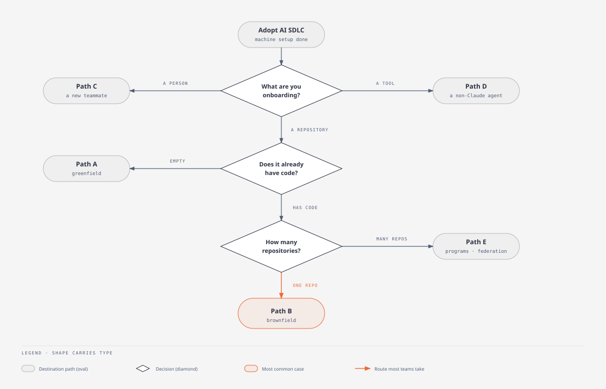
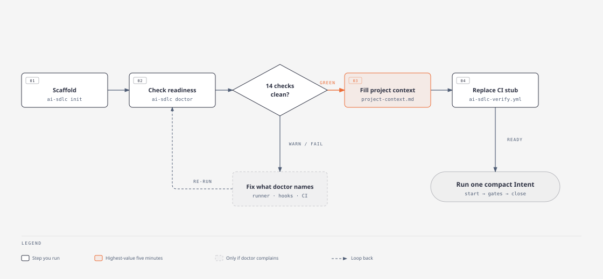
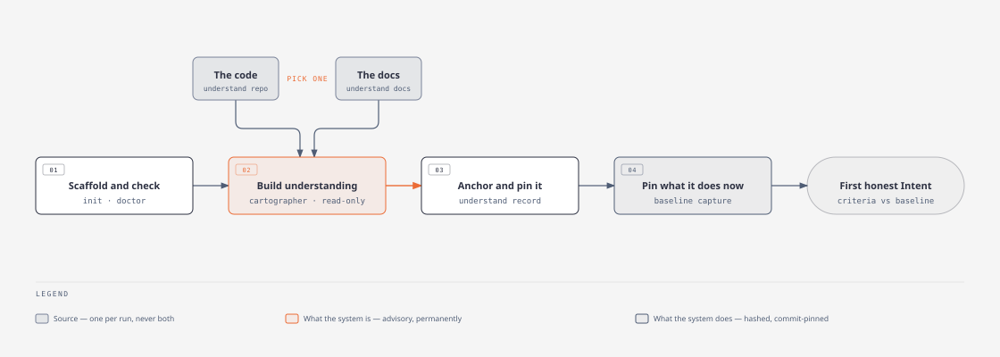

# Onboarding paths

Five ways in. Each is designed to reach a first verified Task quickly, not to be completed in full before work starts.

> **`ai-sdlc` in examples is shorthand** for `python3 "${CLAUDE_PLUGIN_ROOT}/scripts/lifecycle.py"`. Nothing is installed on `PATH`.


Five entry points. Each is designed to reach a working, verified state quickly rather than to be completed in full before any work starts.

<p align="center">
  
</p>

| You are onboarding…             | Path                                                  | Time to first verified Task |
| -------------------------------- | ----------------------------------------------------- | --------------------------- |
| A brand-new project              | [A — greenfield](#path-a--greenfield-repository)      | ~15 minutes                 |
| An existing codebase             | [B — brownfield](#path-b--an-existing-codebase)       | ~30 minutes                 |
| A new person on the team         | [C — a teammate](#path-c--a-new-teammate)             | ~20 minutes reading         |
| A non-Claude agent or tool       | [D — another agent](#path-d--a-non-claude-agent)      | ~5 minutes                  |
| A large program or several repos | [E — organisation scale](#path-e--organisation-scale) | Incremental                 |

---

## Path A — greenfield repository

<p align="center">
  
</p>

```text
cd your-new-project
ai-sdlc init            # or /aisdlc:init from Claude Code, which also explains the result
ai-sdlc doctor
```

**`doctor` is the contract.** Read it before going further. It runs seventeen checks — `runner`, `framework-assets`, `config`, `pipeline`, `delivery-root`, `hooks`, `git`, `runtime-state`, `standing-suites`, `gitignore`, `instrument-boundary`, `reviewer-independence`, `holdout-policy`, `agents-md`, `compatibility`, `schema-generation`, `environment-overrides` — and a `warn` always means something was *weakened* or is incomplete, never that you declined an opt-in hardening.

| Check                   | What it means                                                                                                                                                                               |
| ----------------------- | ------------------------------------------------------------------------------------------------------------------------------------------------------------------------------------------- |
| `runner`              | **Read this first.** It names the `python3` the hook launcher would find. A `fail` means no usable interpreter, and nothing works until there is one.                             |
| `instrument-boundary` | `fail` means the runner is *inside* the repository it judges — someone vendored `scripts/` instead of installing the plugin. That collapses the separation everything else rests on. |
| `hooks`               | `warn` when the guards are not wired, or when a repository initialised before ADR-007 still calls an `ai-sdlc` that is no longer installed.                                             |
| `compatibility`       | The runner and the scaffold disagree on a version. Run `ai-sdlc migrate --apply`.                                                                                                         |
| `schema-generation`   | Records predate this runner's schema. Run `ai-sdlc migrate --apply`.                                                                                                                      |
| `environment-overrides` | `warn` when `AISDLC_HOOKS` or `AISDLC_FRAMEWORK_ROOT` is set in this process. Unset them unless that is deliberate. |

On a fresh repository the expected `warn`s are `delivery-root` and `runtime-state` — both clear the moment you register your first Intent.

Then **one edit and one Intent**:

1. **Fill in `.ai-sdlc/project-context.md`.** Its verification commands become Class D criteria, so a stub left empty weakens every Task that inherits from it. This is the single highest-value five minutes of onboarding.
2. **Run one small compact Intent end to end** before anything real — see [Quickstart](../README.md#quickstart-your-first-verified-task).

That is the whole greenfield path. Everything else in this document is available when you need it and inert until then.

---

## Path B — an existing codebase

Most repositories are not new, and the normal lifecycle assumption — *state what the system should do, then prove it does* — fails badly on a legacy system. Applied literally it produces either a **fiction** (requirements reverse-engineered from the code, encoding today's bugs as intended behaviour) or **paralysis** (nothing starts until everything is specified).

Two artifacts exist to skip both, and they answer different questions:

- The **understanding** records what the system *is* — entry points, module responsibilities, boundaries, data stores, risk concentrations. Advisory, permanently.
- The **baseline** pins what the system *does* — test results, coverage, metrics, fitness checks — hashed and tied to a commit.

Neither asserts anything about correctness. Do them **in that order**, because the understanding is where the baseline's probes come from: writing a probes file for a 500k-line system nobody currently understands is the blank-page problem all over again.

<p align="center">
  
</p>

### 1. Build the understanding

```text
ai-sdlc init
ai-sdlc doctor
/aisdlc:understand repo
```

The `aisdlc-cartographer` agent is read-only, runs once per repository, and holds no lifecycle authority. It writes a single Markdown file, `.ai-sdlc/project-understanding.md`, with an inline anchor on every claim:

```markdown
The auth module manages sessions and refresh rotation. [src/auth/session.py:40-120]
```

Pick **one** source, and never both in one run:

| Mode     | Reads                                | Use when                                                       |
| -------- | ------------------------------------ | -------------------------------------------------------------- |
| `repo` | The codebase                         | You have code and little reliable documentation                |
| `docs` | A declared set of Markdown documents | The documentation is the authority, or the code is unavailable |

The single-source rule exists so every claim's grounding stays recoverable. A document blending code-derived and doc-derived claims cannot tell you which half to distrust when the two disagree.

```text
ai-sdlc understand record     # validate anchors, stamp the git pin
ai-sdlc understand status     # fresh · drifting · stale, and which claims moved
```

`understand record` stamps the `commit` and `recorded_at` frontmatter after validating the document. **Never write those two fields by hand** — doing so claims a validation that never ran. The prose and anchors above them are yours to edit freely.

### 2. Capture the baseline

The understanding proposes checks; it does not enforce them. **There is no promotion command, by design** — you copy accepted lines into your probes file yourself, one at a time, because a check nobody chose is a check nobody owns.

```text
ai-sdlc baseline capture probes.yaml
ai-sdlc baseline compare BASELINE-001
```

The baseline pins current behaviour, hashed and tied to a commit, so an existing system can state honest criteria on day one — *"no worse than BASELINE-001"* is a real, testable criterion.

### 3. Adopt incrementally

Start the first Intent with criteria measured against the baseline rather than against an imagined ideal. Widen scope as the understanding and the baseline earn trust.

---

## Path C — a new teammate

Point them at three things, in order:

1. **`AGENTS.md` in the repository root** (written by `init`). Short, states the non-negotiable rules, the command surface, and — usefully — *what the runner will refuse*. It is written for agents, which makes it an unusually blunt and accurate summary for people.
2. **`.ai-sdlc/constitution.md`.** The rules that are not negotiable by an agent, a Task, or a deadline. About one page.
3. **The [Quickstart](../README.md#quickstart-your-first-verified-task)**, then shadow one compact Intent.

On a brownfield repository, add `.ai-sdlc/project-understanding.md` if one has been recorded — it is the fastest orientation to the system itself, and every claim carries a `[path:lines]` anchor they can go read. Tell them what it is worth: it is advisory, a model wrote it, and `ai-sdlc understand status` says whether it has drifted.

The mental model that makes everything else obvious:

> Claude and humans create and change *source artifacts*. The runner decides whether the lifecycle may move forward. **If the runner did not record it, it did not happen.**

The three most common early mistakes, worth saying out loud on day one:

- **Editing `.ai-sdlc/runtime/` to "fix" a state.** Use `ai-sdlc repair-state --confirm` instead; hand-editing is blocked by hooks and breaks the audit chain.
- **Treating a held-out failure as a flaky test.** It is the opposite of flaky — it is the most informative signal the framework produces.
- **Committing `.ai-sdlc/runtime/`.** It makes convergence permanently unsatisfiable. `init` gitignores it for you.

---

## Path D — a non-Claude agent

The deterministic core has no Claude Code dependency.

```text
ai-sdlc init            # writes AGENTS.md alongside everything else
```

`AGENTS.md` carries the constitution summary, the runner-owned path list, the command surface, and what the runner refuses. Any AGENTS.md-reading agent receives the doctrine, and the runner keeps the authority regardless of which agent is driving.

Every runner command emits stable JSON on stdout, so another agent drives the same
lifecycle by running the same script — there is no second interface to keep in sync, and
no separate surface that could drift from the one Claude uses.

Claude Code hooks remain an *advantage* — they block invalid edits before they happen — not a *requirement*. Under another agent the same rules are enforced at the runner boundary instead, one step later.

---

## Path E — organisation scale

Add these only when the corresponding pain is real. Every one of them is inert until invoked.

| Pain                                           | Reach for                  | Command                                                   |
| ---------------------------------------------- | -------------------------- | --------------------------------------------------------- |
| One initiative spans many Intents              | Programs                   | `ai-sdlc program new --title "…" --owner …`           |
| Two teams keep colliding on a schema or prompt | Intent-scope contention    | `ai-sdlc intent-resources I00X --declare schema:orders` |
| Gates feel slow                                | Gate packets, then measure | `ai-sdlc gate-packet I00X G3`                           |
| Nobody can say what the process costs          | Cost and DORA export       | `ai-sdlc metrics cost` · `ai-sdlc metrics export`    |
| Compliance is asking questions                 | Conformance projection     | `ai-sdlc export-conformance I00X`                       |

**Programs** group Intents into one initiative with ordering and roll-up — and carry no gates, criteria, or evidence of their own.

Cross-repository Intents are **not** supported. Federation admitted evidence from another repository by verified signature, and the signing path went with CI (ADR-007). Run one Intent per repository and order them with a Program.

Two things deliberately **do not** exist, and should not be added:

- **Risk tiers that loosen rigor by label** — the mechanism by which rigor gets negotiated away. [Pipeline profiles](reference.md#pipeline-profiles-adr-010) may tighten any rule, but loosen a default only through a recorded waiver, and never touch the constitution (ADR-010). Attack gate *cost* instead.
- **Additional agent personas** — more agents, more tokens, more handoff failure surface, and no authority anywhere.
