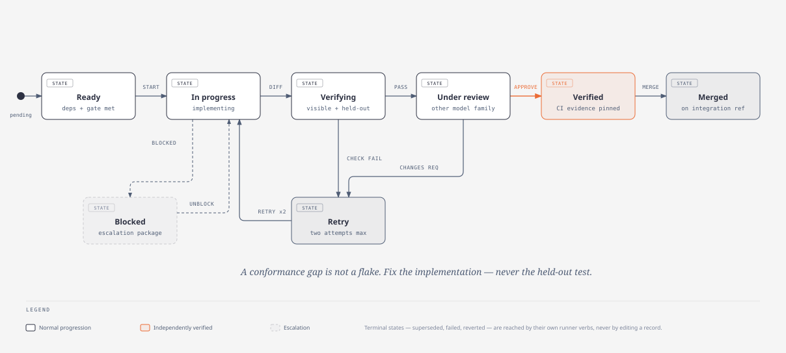
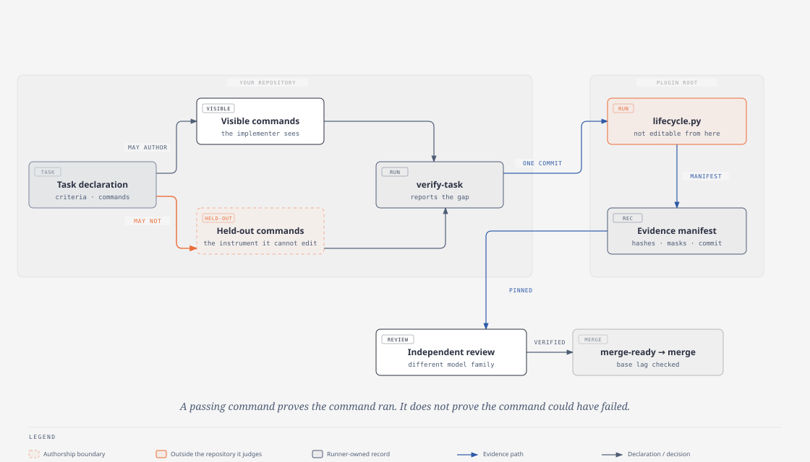

# How verification works

How a Task moves from ready to merged, what evidence records, how convergence is decided, and the full capability catalogue.

> **`ai-sdlc` in examples is shorthand** for `python3 "${CLAUDE_PLUGIN_ROOT}/scripts/lifecycle.py"`. Nothing is installed on `PATH`.

## The Task state machine


This is the part that makes the rest worth doing. A Task moves through a state machine the runner owns; no state is reached by editing a file.

<p align="center">
  
</p>

Two retries are allowed. A third failed attempt moves the Task to `blocked` and creates an escalation package. Terminal states have their own verbs, so an outcome is never recorded by editing a record:

```text
ai-sdlc supersede-task I001-P02-T004 --reason "Replaced by peer Tasks" --replaced-by I001-P02-T007
ai-sdlc fail-task      I001-P03-T002 --reason "Escalation resolved by abandoning the Task"
ai-sdlc revert-task    I001-P02-T003 --reason "Defect surfaced on trunk" --corrective I001-P04-T006
```

## The evidence chain

<p align="center">
  
</p>

**Held-out verification.** A Task declares *visible* commands (which the implementing agent may author) and *held-out* commands (which it may not). `verify-task` runs both in one attempt against one commit and reports the delta:

```json
"conformance": {
  "visible_pass_rate": 1.0,
  "holdout_pass_rate": 0.0,
  "gap": 1.0,
  "conformance_gap": true
}
```

A `conformance_gap` means the implementation satisfies the tests it was given rather than the requirement those tests stand for.

> **Fix the implementation. Never the held-out test.**
> This is not a flaky result and must not be retried as though it were.

Held-out verification applies in **both** compact and full mode. In compact mode the instrument may be as small as one verifier-authored test — the requirement is *provenance*, not volume.

**The instrument sits outside the repository it judges.** There is one kind of evidence, and the runner captures all of it. What makes a manifest worth more than a claim is *where the capturing code lives*: `scripts/lifecycle.py` is inside the plugin directory, not in your working tree. An implementing session can write anywhere in the repository and still cannot edit the code that decides whether its work passed. The `PreToolUse` guard enforces that boundary, refusing any edit that resolves inside the plugin root.

Every manifest records the exact commands, exit codes, timings, SHA-256 of each captured stream, and the **Git commit it was pinned to**. A pin against a stale commit is a failure, not a formality.

Every manifest also records the **declared sandbox posture** — network policy, filesystem scope, credential surface — and **masks secrets before hashing**, because evidence is immutable: a credential that reaches a manifest is pinned there by the same machinery that makes evidence trustworthy. Every mask is length-annotated and counted, and a stream that redaction consumed rather than cleaned is reported as a validation problem.

> **What this evidence is not.** It is not signed, and it does not prove anything to somebody who does not already trust the machine that produced it. Signed provenance needed a CI workload identity, and CI was removed — see [ADR-007](decisions/0007-the-plugin-root-is-the-trust-boundary.md), which records exactly what was traded away. The property that survived is the one that changes daily behaviour: **the implementer cannot grade itself.**

**Independence is checked by model family.** Register a review from a fresh context:

```text
Use the aisdlc-verifier agent to review I001-P00-T001 against its captured evidence.
```

```yaml
reviewer_agent_id: verifier-01
reviewer_model: opus-5           # required; must differ in family from the implementer
implementer_model: claude-fable-5
decision: approved
checks:
  requirements: passed
  evidence: passed
  tests: passed
findings: []
```

The runner validates reviewer independence by model family, review schema, evidence hashes, source commit, and specification pins before moving the Task to `verified`. **A review with no `reviewer_model` is rejected** — the runner fails closed rather than assuming independence it cannot check. For Class N criteria or threat-sensitive changes, also use `aisdlc-red-team`.

**Merging is gated on freshness too.** `merge-ready` passes only when the Task is verified, its review is approved, evidence is untampered and pinned to the same commit, the verified base is not more than `merge.max_base_lag` commits behind the integration branch, and integration checks are clean.

## Convergence

Commit all tracked source changes, then `ai-sdlc converge I001`. Convergence requires:

- every required Task verified or merged, and G4 approved;
- latest evidence untampered and correctly pinned to the converged commit;
- approved independent reviews and complete bidirectional traceability;
- passing, non-stale S/J/N evaluation manifests and passing inherited suites;
- no open Critical or High finding, and **no unresolved conformance gap**;
- **held-out coverage or a recorded waiver for every behavioural Task**;
- passing declared mutation thresholds and valid baseline references;

Order matters: **commit the source, capture evidence, converge, then commit the generated records.** Evidence pins to the commit it was captured at, so a commit made after capture leaves the clean-tree check permanently unsatisfiable.

---

## Compact or full mode

Use `compact` **only** when all of these are true:

- The change fits one Build Phase and one or a few Tasks.
- Every acceptance criterion is deterministic Class D.
- There is no model behaviour, security boundary, external side effect, migration, public-interface change, or irreversible action.
- Dependencies and shared resources are simple enough to review together.

Use `full` for everything else. **Model-dependent work always uses full mode.**

```text
ai-sdlc new --title "Improve status guidance"        --type feature --mode compact --discovery-reason "small, well-understood change; nothing to discover"
ai-sdlc new --title "Add grounded support assistant" --type feature --mode full --contains-model-behavior --discovery-reason "new capability; no existing code to map"
```

Every criterion carries **exactly one** verification class:

| Class       | Settled by                                             | Typical use                                              |
| ----------- | ------------------------------------------------------ | -------------------------------------------------------- |
| **D** | A deterministic command the runner executes and hashes | Tests, static checks, migrations, performance thresholds |
| **S** | Statistical adjudication against predeclared rules     | Pass rates over a dataset, sequential stopping           |
| **J** | A judged evaluation with a calibrated rubric           | Grounding, tone, refusal behaviour                       |
| **N** | Adversarial / negative adjudication                    | Jailbreaks, prompt injection, unsafe completions         |

S, J, and N run through `ai-sdlc eval execute`, where **the runner calls the adapter and writes per-case results itself** — no agent stands between the model and the evidence. Judge calibration is held to current practice: a 0.85 agreement floor (raisable, never lowerable), generator/judge family separation, dual-order judgments, decomposed binary rubrics, annotated exemplars, reasoning before score, and a recorded human-review queue.

---

## Capability catalogue

<details open>
<summary><b>Lifecycle and authority</b></summary>

- Compact and full delivery paths using the same lifecycle.
- Permanent Intent, Program, Phase, Task, requirement, criterion, evaluation, baseline, decision, finding, and lesson identifiers.
- **Architecture as a record, not a heading.** Structural calls are recorded as decisions with permanent identifiers and individual content hashes, so a Task traces to one and a changed decision invalidates exactly the Tasks that declared it — never the rest.
- **Adversarial review before the gate.** Gate 2 and Gate 3 require a recorded fresh-context review of the artifact they approve, pinned to that artifact so a later edit shows up as a review that no longer covers it. The review informs the human decision; it never makes it.
- **Discovery is a recorded decision.** Skipping it requires a reason, because an unexplained skip and an oversight look identical six months later.
- Five auditable human approval gates, with a configurable policy for *who may approve* each one.
- Gate-enforced execution: no Task runs before the human approval that authorizes it.
- Audit-based recovery when runtime state becomes corrupt.

</details>

<details>
<summary><b>Evidence you can trust</b></summary>

- Retained deterministic evidence: commands, stdout, stderr, exit codes, timings, hashes, Git commit, and specification pins.
- **Held-out verification.** A visible suite that passes while the held-out suite fails is reported as a *specification-conformance finding*, not retried as a flake.
- **The instrument boundary.** The capturing runner lives in the plugin directory, outside the repository under change, and the guard refuses any edit that reaches it — so the code deciding whether a criterion passed cannot be authored by the session trying to pass it.
- **Mutation score** as a Class D companion, with surviving mutants fed back as structured retry input.
- **Declared sandbox posture** recorded in every manifest: network policy, filesystem scope, credential surface.
- **Secrets masked before hashing.** Captured output and the recorded invocation are redacted *before* the manifest is written, because evidence is immutable. Every mask is length-annotated and counted in the manifest, and a stream that redaction consumed rather than cleaned is reported as a validation problem.

</details>

<details>
<summary><b>Evaluation of model behaviour</b></summary>

- Statistical, judged, and adversarial Class S/J/N adjudication against predeclared rules.
- **Runner-driven evaluation** (`eval execute`): the runner calls the adapter and writes per-case results itself, so no agent stands between the model and the evidence.
- Judge calibration to current practice: a 0.85 agreement floor, generator/judge family separation, dual-order judgments, decomposed binary rubrics, annotated exemplars, reasoning before score, and a recorded human-review queue.

</details>

<details>
<summary><b>Scale</b></summary>

- **Programs** group Intents into one initiative with ordering and roll-up — and carry no gates, criteria, or evidence of their own.
- **Intent-scope resource contention**, surfaced for a human to serialize or co-approve on the record.
- **Scoped specification invalidation**: a reopened Gate 2 invalidates only the evidence tracing to requirements that actually changed.
- **Project understanding** for brownfield entry: one anchored, git-pinned Markdown file recording what an existing system *is*, derived from the code or from documents — never both in one run, so every claim's grounding stays recoverable. Advisory, permanently.
- **Characterization baselines** for brownfield entry, so an existing system can state honest criteria on day one.
- **Migration safety**: paired forward/rollback/invariant evidence and a static expand/contract phase-ordering check.

</details>

<details>
<summary><b>Economics and assurance</b></summary>

- **Gate packets** (`gate-packet`): a two-minute decision page instead of an archaeology exercise.
- **Cost instrumentation**: the verification tax and per-gate latency, measured rather than assumed.
- **Criterion discrimination**: a criterion that never fails is measured and then defended or retired, like any other decaying control.
- **Conformance export** onto NIST AI RMF, ISO/IEC 42001 Annex A, and NIST SSDF — a read-only projection of records you already hold.
- **Metrics export** in JSON and OpenMetrics, with DORA proxies labelled as proxies.
- **Verifiable gate identities.** Every gate decision records how strongly it is bound to a person — `declared` (a name the caller supplied, still the default) or `verified` (bound to an identity the runner checked). The conformance export reports the split instead of implying the stronger one, and reports the controls it *cannot* substantiate as unmet rather than quietly omitting them.
- A learning loop that promotes findings into regression suites, policies, checklists, or context heuristics — at each Build Phase boundary as well as at close, so one phase's lesson lands before the next phase repeats it.

</details>

<details>
<summary><b>The plugin itself</b></summary>

- **Guards that cost nothing where they do not apply.** The hook dispatch happens before the runner's dependency graph is imported, so an unmanaged repository is recognised and dismissed in a third of the time — 494 ms saved per tool call, measured on Windows (`python tools/measure_hook_latency.py`).
- **A cross-platform hook seam with nothing to hijack.** Hooks call an absolute path under `${CLAUDE_PLUGIN_ROOT}` through a polyglot launcher that dispatches under both `cmd.exe` and any POSIX shell, probing Git Bash at its standard install locations. There is no bare name for a cloned repository to shadow (ADR-007).
- **Session orientation.** A `SessionStart` digest reports the lifecycle state, the pending gate, and its decision packet before the first edit — silent in repositories that never adopted the lifecycle.
- **Versioned records and a migration path.** Every runner-owned record carries a schema generation; `ai-sdlc migrate` moves a repository forward, and a runner meeting a record from a newer generation says so instead of reporting it as malformed. Captured evidence is never rewritten — it is hashed, so it is migrated by being tolerated, not by being stamped.
- **Zero runtime dependencies.** `typer`, `pydantic`, `pyyaml`, and `jsonschema` are gone — replaced by an argparse shim, dataclasses, a vendored pure-Python parser, and a schema validator differential-tested against the real one. Nothing is ever `pip install`ed.

</details>
